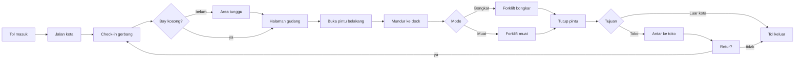
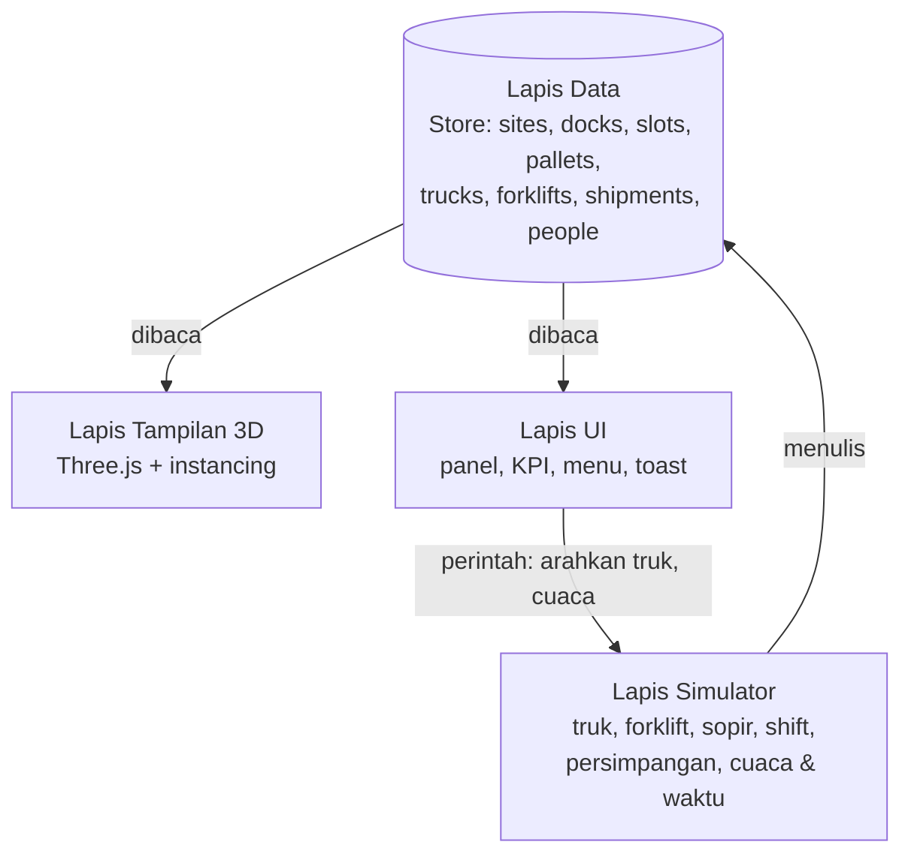

<div align="center">


# Dashboard Operasional Gudang 3D

**Lumbung v39** · oleh PT Fusionify Digital


Pantau dock, truk, forklift, stok, pekerja, dan pengiriman di lima gudang — dalam satu peta 3D isometrik yang hidup.

[](#teknologi)
[](#struktur-proyek)
[](#lima-gudang-lima-karakter)
[](#kualitas--pengujian)
[](#performa)
[](#peta-jalan)

[](https://lumbung.fusionify.id)

</div>

---

## Jelajahi Lumbung

| | |
|---|---|
| [✨ Fitur Utama](#fitur-utama) | [🏭 Lima Gudang, Lima Karakter](#lima-gudang-lima-karakter) |
| [🚚 Alur Truk](#alur-truk) | [🧱 Arsitektur](#arsitektur) |
| [🛠️ Teknologi](#teknologi) | [📁 Struktur Proyek](#struktur-proyek) |
| [▶️ Menjalankan](#menjalankan-di-komputer) | [🌐 Deploy](#deploy) |
| [🖱️ Kontrol](#kontrol--interaksi) | [✅ Kualitas & Pengujian](#kualitas--pengujian) |
| [⚠️ Batasan](#batasan-yang-diketahui) | [🗺️ Peta Jalan](#peta-jalan) |

---

## Fitur Utama

### 🏭 Lima Gudang Berkarakter
Setiap gudang punya bentuk bangunan, kendaraan, peralatan, seragam, dan **cara kerja** sendiri — dari gudang umum, cross-dock, pusat distribusi, rantai dingin, sampai hub robotik.

### 🚚 Truk & Pengiriman yang Bisa Diarahkan
Truk datang lewat tol, **check-in di gerbang gudang** (petugas mengecek surat jalan lalu membuka palang), menunggu di **area tunggu** bila semua bay terisi, lalu sopir membuka pintu belakang dan mundur ke dock. Pilih truk dan **arahkan tujuannya** ke toko mana pun — bahkan saat truk sudah di perjalanan, rute dihitung ulang dari persimpangan berikutnya. Truk muat juga bisa dikirim **antar-gudang**, truk yang masih di tol bisa dialihkan ke gudang lain, dan truk yang sedang menuju dock bisa dipindah ke bay lain.

### 🏗️ Forklift & AGV
Forklift memindahkan palet antara slot dan truk dengan antrean tugas, anti-kebuntuan, dan stasiun pengisian. Di Hub Robotik, **AGV otonom** memproyeksikan jalurnya di lantai.

### 👷 Pekerja & Shift
Shift Pagi (06.00–18.00) dan Shift Malam (18.00–06.00) dengan seragam dan nama berbeda. Satpam berjalan ke pos untuk serah terima; sopir truk istirahat di Pos Sopir; operator gudang berkeliling memeriksa rak, palet masuk, dan tumpukan krat. Jam makan (12.00 dan 00.00) dibagi dua gelombang: pekerja berjalan ke kantin di belakang gudang, mengambil makanan, lalu makan bersama, sementara operator forklift istirahat bergiliran satu per gudang supaya dock tetap terlayani.

### 🌦️ Waktu & Cuaca
Real-time (WIB), pagi, siang, sore, malam, atau siklus cepat — plus cerah, berawan, hujan, badai petir, kabut, dan badai pasir. Cuaca memengaruhi kecepatan truk, forklift, dan jarak pandang.

### 🛣️ Kota, Jalan Raya & Tol
Grid jalan kota dengan lampu lalu lintas, zebra cross, dan garis stop di lajur kiri; Jalan Lingkar; serta **Tol Jagorawi** 4 lajur dengan median beton, guardrail, dan gantry hijau.

### 🎬 Sinematik & Tampilan Bersih
Mode sinematik **bercerita**: kamera mengikuti satu truk tanpa potong, dari Gerbang Tol Jagorawi, masuk halaman, sopir membuka pintu, mundur ke dock, sampai forklift mulai bongkar-muat, lalu terbang mulus ke cerita berikutnya. Tampilan Bersih menyembunyikan rambu dan lalu lintas kota agar fokus ke operasional gudang.

### 🚨 Peringatan yang Bisa Ditindaklanjuti
Pusat peringatan memantau operasi terus-menerus dan setiap peringatan punya **tombol aksi yang langsung mengubah jalannya operasi**:

| Peringatan | Aksi |
|---|---|
| Truk tertahan > 60 detik | Lihat truk · alihkan ke toko lain |
| Truk menunggu stok untuk dimuat | Berangkatkan dengan muatan yang ada |
| Gudang hampir penuh / hampir kosong | Prioritaskan truk muat / bongkar 10 menit |
| Stok barang menipis | Pesan restock (tiba bersama truk bongkar berikutnya) |
| Baterai forklift rendah | Kirim ke stasiun pengisian |
| Cuaca ekstrem | Kembalikan cuaca cerah |

Peringatan selesai otomatis saat kondisinya pulih, dan semuanya tercatat di riwayat.

### 📊 Panel & KPI
Kartu KPI dengan grafik tren mini, grafik **Kinerja khas** per jenis gudang (suhu ruang 24 jam, waktu transit cross-dock, paket per jam, peta panas AGV, waktu truk di dock) yang dihitung langsung dari simulasi, panel detail per objek, pelacakan pengiriman, notifikasi toast, tooltip saat hover, mode gelap, dan tata letak responsif dari ponsel sampai layar lebar.

---

## Lima Gudang, Lima Karakter

| Gudang | Profil | Ciri visual | Cara kerja khas |
|---|---|---|---|
| **BGR-01** Hub Cibinong | Gudang umum | Bangunan bergelombang biru, rak tinggi | Bongkar-muat campuran, simpan di rak |
| **BGR-02** Cross-Dock Sentul | Transit cepat | Dock hijau (inbound) & oranye (outbound), tanpa rak | Dock kiri hanya bongkar, dock kanan hanya muat |
| **BKS-01** DC Cikarang | Pusat distribusi | Jendela atap kaca, armada van & motor kurir ungu | Lebih banyak mengirim; kurir motor berkeliling kota |
| **BGR-03** Gudang Dingin Cileungsi | Rantai dingin | Panel putih, kipas kondensor berputar, uap dingin, truk berpendingin | **Cek suhu muatan** sebelum bongkar; forklift lebih hati-hati |
| **DPK-01** Hub Robotik Depok | Otomatisasi | Panel surya, kaca gelap, charger truk listrik | **AGV tanpa sopir** dengan proyeksi jalur |

Ditambah dua tujuan pengiriman: **TK-01 Segar Mart** dan **TK-02 Nusantara Plaza**.

---

## Alur Truk



Aturan keselamatan yang dijaga simulator:

- Truk berhenti **di belakang garis stop**, tidak pernah di atas zebra cross.
- Truk masuk persimpangan hanya jika ada ruang untuk **seluruh badannya** di seberang.
- Pintu belakang dibuka **di halaman gudang**, tidak di jalan raya.
- Truk berhenti bila ada sopir atau pekerja di jalurnya.
- Bay dibagikan sesuai urutan check-in, dan palang hanya dibuka bila truk muat sepenuhnya di area tunggu, jadi antrean tidak meluber ke jalan raya.
- Mobil belok kiri/kanan atau putar balik mengikuti lampu dan hanya bila lajur tujuan punya ruang; mobil yang belok mengalah pada penyeberang jalan, dan penyeberang hanya mulai saat lampu penyeberang hijau.
- Truk menyalakan sein sebelum berbelok, lampu rem saat mengerem atau antre, lampu mundur saat mundur ke dock, dan hazard bila tertahan lama. Mobil kota ikut menyalakan lampu rem.

---

## Arsitektur

Empat lapis yang terpisah tegas — sehingga simulator bisa diganti data nyata tanpa menyentuh tampilan.



| Lapis | Tanggung jawab |
|---|---|
| **Data** | Tabel entitas, relasi, log kejadian, jam & cuaca |
| **Simulator** | State machine truk, antrean tugas forklift, rute Dijkstra di grid kota, klaim persimpangan, prosedur per profil gudang |
| **Tampilan 3D** | Model dibuat dari kode, `InstancedMesh` untuk palet, orang, mobil, dan motor; sinkronisasi per frame |
| **UI** | Panel detail, pelacakan, KPI + sparkline, menu Waktu & Cuaca, mode sinematik |

---

## Teknologi

| Komponen | Pilihan |
|---|---|
| Rendering 3D | Three.js r128 (CDN) |
| Bahasa | JavaScript murni (tanpa framework, tanpa build saat runtime) |
| Tipografi | Plus Jakarta Sans |
| Model 3D | Dibuat dari kode — tidak ada file aset eksternal |
| Bayangan & cahaya | Shadow map, PMREM environment, sprite cahaya malam |
| Distribusi | Satu file `index.html` |

---

## Struktur Proyek

```text
Lumbung/
├── src/
│   ├── shell.html     # kerangka HTML & seluruh CSS
│   ├── a_core.js      # store data, konfigurasi gudang & toko, utilitas
│   ├── b_layout.js    # pembuatan gudang, slot, palet, armada, pekerja
│   ├── c_sim.js       # simulator: truk, forklift, sopir, shift, persimpangan, rute, cuaca
│   ├── d_part1.js     # model 3D, pool instancing, kota & jalan
│   ├── d_part2.js     # bangunan gudang, sinkronisasi tampilan per frame
│   └── e_ui.js        # antarmuka, panel, KPI, interaksi
├── tests/
│   └── headless-sim.mjs  # uji simulator tanpa browser: node tests/headless-sim.mjs 30
├── index.html         # hasil rakitan — file yang di-deploy
├── build.mjs          # merakit src/ → index.html
├── package.json
├── vercel.json        # konfigurasi Vercel
├── _headers           # konfigurasi Cloudflare Pages / Netlify
├── CARA-DEPLOY.md     # panduan deploy ke lumbung.fusionify.id
├── KONTEKS-PROYEK.md  # rujukan lengkap untuk pengembangan (arsitektur, aturan, backlog)
├── CLAUDE.md          # peta kode rinci (nomor baris, temuan audit, resep pengembangan)
├── CHANGELOG.md
└── README.md
```

---

## Menjalankan di Komputer

Butuh Node.js 18+ (hanya untuk merakit; aplikasinya sendiri tanpa dependensi).

```bash
npm run build   # rakit src/ menjadi index.html
npm start       # server lokal → http://localhost:3000
```

Atau cukup buka `index.html` langsung di browser.

> Butuh koneksi internet untuk memuat Three.js dan font dari CDN.

---

## Deploy

Ringkasnya (Vercel):

1. Unggah folder ini di **vercel.com/new**.
2. Tambahkan domain `lumbung.fusionify.id` di **Settings → Domains**.
3. Tambahkan DNS `CNAME lumbung → cname.vercel-dns.com`.

Panduan lengkap — termasuk Cloudflare Pages dan Nginx — ada di [`CARA-DEPLOY.md`](CARA-DEPLOY.md).

---

## Kontrol & Interaksi

| Aksi | Cara |
|---|---|
| Geser peta | Seret dengan mouse / satu jari |
| Zoom | Scroll / cubit dua jari, atau tombol `+` `−` |
| Putar kamera | Tombol putar di kontrol peta |
| Pilih objek | Klik truk, forklift, pekerja, dock, palet, gudang, atau toko |
| Info cepat | Arahkan kursor ke objek |
| Cari | Tekan `/` lalu ketik ID truk, forklift, palet, atau lokasi |
| Arahkan truk | Pilih truk yang sedang dimuat atau menuju toko → kartu **Arahkan pengiriman** |
| Peringatan | Klik ikon lonceng → tab **Peringatan** → pilih aksi |
| Waktu & cuaca | Klik chip cuaca di bar atas |
| Tampilan Bersih | Tombol ✦ di kontrol peta |
| Ukuran tampilan | Menu Waktu & Cuaca → **Ringkas / Otomatis / Besar** |
| Mode sinematik | Tombol kamera di kontrol peta |
| Tabel data | Tombol **Tabel** di bar atas |

---

## Kualitas & Pengujian

Simulator diuji otomatis dengan skenario 13 menit (siang, malam, dan siklus cepat) serta uji ketahanan 30 menit. Uji yang sama bisa dijalankan siapa saja:

- **Di browser:** buka `lumbung.fusionify.id/?selftest` (opsional `&menit=13&jam=malam&seed=7`, atau jam bebas seperti `&jam=11.9`). Simulasi dipercepat lalu muncul laporan 27 pemeriksaan keselamatan (termasuk validitas angka KPI, gerbang check-in, dan perpindahan truk antar-gudang). Selama uji, "operator uji" otomatis ikut memindah bay, mengalihkan truk, dan mengirim antar-gudang.
- **Di terminal:** `node tests/headless-sim.mjs 13 7 siang` (menit, seed, jam). Keluar dengan kode 1 bila ada pemeriksaan yang gagal, jadi bisa dipakai sebelum push.
- **Seed:** `?seed=123` membuat keputusan acak simulator bisa diulang. Seed yang sedang dipakai tampil di menu Waktu & Cuaca, lengkap dengan tombol salin tautan. Browser dan terminal menghasilkan sidik jari keadaan yang sama untuk seed, durasi, dan jam yang sama.

| Pemeriksaan | Hasil |
|---|---|
| Tabrakan truk, mobil, forklift, sopir | **0** |
| Kebuntuan / truk tertahan permanen | **0** |
| Kendaraan berhenti di zebra cross | **0** (16 skenario regresi lulus sejak v33.1) |
| Pintu truk dibuka di jalan raya | **0** |
| Cross-dock: truk di dock arah yang salah | **0** dari >8.000 pemeriksaan per 13 menit |
| Gudang dingin: palet dipindah sebelum cek suhu | **0** |
| Truk yang diarahkan tiba di tujuan yang salah | **0** |
| Truk sampai di dock tanpa check-in gerbang | **0** |
| Palang gerbang menutup di atas truk | **0** |
| Truk antre di jalan raya depan gerbang > 45 dtk | **0** |
| Pejalan kaki saling tunggu / tertahan > 30 dtk | **0** |
| Lebih dari 1 forklift per gudang istirahat bersamaan | **0** |
| Pergantian shift tuntas | 100% |
| Orang dengan bagian tubuh hilang | **0** dari 99 |
| Tata letak di 6 ukuran layar (390 px – 1600 px) | Tidak ada yang meluap atau tertutup |

---

## Performa

| Tampilan | Draw call (profil ponsel) |
|---|---|
| Satu gudang | ±116–122 |
| Badai petir | ±117–123 |
| Seluruh kota | ±135–150 |

Ponsel dan perangkat hemat daya otomatis memakai bayangan lebih ringan dan simulasi bergiliran untuk gudang yang tidak sedang dilihat.

---

## Batasan yang Diketahui

- **Data masih simulasi** — belum terhubung ke WMS, GPS armada, atau sensor dock.
- Tujuan pengiriman: dua toko, empat gudang lain, dan luar kota via tol.

---

## Peta Jalan

- [x] KPI & grafik khas per jenis gudang (suhu 24 jam, waktu transit, peta panas AGV) · v31
- [x] Simulasi dengan *seed* + mode uji mandiri (`?selftest`) · v30
- [x] Check-in gerbang & area tunggu truk · v32
- [x] Pengiriman antar-gudang & mengarahkan truk yang sedang datang · v33
- [x] Lampu sein, rem, mundur, dan hazard truk · v34
- [x] Garis waktu & putar ulang 10 menit terakhir · v35
- [x] KRL layang, bayangan awan, suara suasana, dan mode foto · v36
- [x] Truk mogok + kirim mekanik, jas hujan · v37
- [x] Jenis jalan dibedakan, mobil belok & putar balik, lampu & penyeberang jalan · v38
- [x] Istirahat makan bergiliran & kantin pekerja · v39
- [ ] Integrasi data nyata — termasuk sebagai tampilan "Toko Live" FUSIONIFY BOT
- [ ] Migrasi ke TypeScript + Three.js terbaru

---

## Kredit

Terinspirasi oleh video konsep dashboard gudang **WareTrack**. Lumbung dibangun ulang dari nol: nama, logo, model 3D, dan kode adalah milik sendiri — tidak ada aset atau merek WareTrack yang disalin.

<div align="center">

**© 2026 PT Fusionify Digital** · Bogor, Indonesia

</div>
